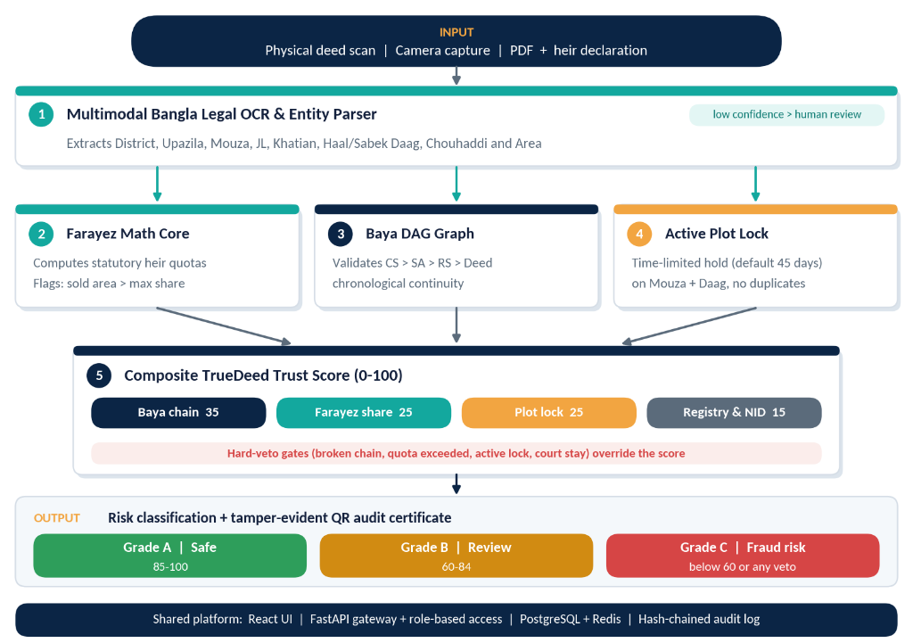

<div align="center">

# 🛡️ TrueDeed (LA-72)
### Algorithmic Land Fraud & Double-Selling Prevention Platform
**National Decision-Support System for Pre-Registration Title Verification & Fraud Interception**

[](https://frontend-five-sage-86.vercel.app)
[](https://github.com/Ishtiak-Ahmed886/TrueDeed)
[](https://github.com/Ishtiak-Ahmed886/TrueDeed)
[](https://github.com/Ishtiak-Ahmed886/TrueDeed)
[](https://frontend-five-sage-86.vercel.app)
[](LICENSE)

<br/>

### 🌐 [👉 Click Here to Test the Live Prototype on Vercel (Available 24/7)](https://frontend-five-sage-86.vercel.app) 👈

**[📄 Read Official 4-Page Concept Note (PDF)](./TrueDeed_Concept_Note_Official.pdf)** &nbsp;•&nbsp;
**[🏛️ Interactive Architecture Gallery](./Architecture_and%20Data_flow/Architecture_Gallery.html)** &nbsp;•&nbsp;
**[🚀 Interactive Prototype Guide](#-3-interactive-prototype-suite-live-on-vercel)** &nbsp;•&nbsp;
**[👥 Team & Mentors](#-10-team--mentorship-rule-book-section-6)**

---

</div>

## 📌 1. Executive Summary & National Urgency

Over **70% of all civil litigations in Bangladesh**—representing approximately **3.5 million pending cases** in formal courts—originate from land ownership disputes, forged deeds, and unauthorized transfers. 

### The Institutional Void
The root cause is a systemic institutional disconnect between two distinct government authorities:
1. **The Ministry of Law (Sub-Registry Offices):** Exercises statutory authority over deed registration under the *Registration Act 1908*, but lacks automated visibility into live khatian mutation statuses or physical boundary encumbrances.
2. **The Ministry of Land (Upazila Land Offices / AC Land):** Administers mutation records (*e-Namjari*) and revenue records (*e-Porcha*), but historically operates asynchronously from registration desks.

Under **Problem P3: Catch Fraud & Double-Selling**, **TrueDeed** builds an automated, sub-second pre-registration verification layer. It intercepts fraudulent land sales **before** registration by mathematically auditing statutory inheritance quotas, validating Baya deed chain-of-title lineage, and enforcing real-time transactional concurrency locks.

---

## 🏛️ 2. Modern System Architecture

The following diagram illustrates the complete, end-to-end multi-layer architecture of TrueDeed—from physical Bengali deed ingestion to automated algorithmic verification and QR-verifiable certificate dispatch:

<p align="center">
  
</p>

---

## 🚀 3. Interactive Prototype Suite (Live on Vercel)

The live production prototype demonstrates the full technical workflow across **3 dedicated applications** and **3 stakeholder roles**:

### 🌐 Live Production URL: [https://frontend-five-sage-86.vercel.app](https://frontend-five-sage-86.vercel.app)

```
┌────────────────────────────────────────────────────────────────────────────────────────┐
│                                 TRUEDEED APPLICATION SUITE                             │
├──────────────────────────┬─────────────────────────────┬───────────────────────────────┤
│ 1. Verification Cockpit  │ 2. Baya DAG Lineage Tracer  │ 3. Farayez Sandbox Engine     │
│  - Multimodal Bangla OCR │  - 5-Node Title Chain       │  - Hanafi Quota Math Engine   │
│  - Hard Veto Rules Matrix│  - CS 1921 → 2026 Proposed  │  - Live Interactive Donut     │
│  - Dynamic QR Certificate│  - Missing DCR Fracture Pt  │  - Real-Time Quota Interceptor│
└──────────────────────────┴─────────────────────────────┴───────────────────────────────┘
```

### 1️⃣ Page 1: Pre-Registration Verification Cockpit (`যাচাই ককপিট`)
- **Dual Live Scenarios:** One-click toggling between **Verified Valid Title (94% Trust Score)** and **Critical Fraud Intercepted (18% Trust Score)**.
- **Executive Metadata Command Strip:** Live metadata badges with real-time radar-pulse connection to Sub-Registry APIs.
- **OCR Ingestion & JSON Schema:** Side-by-side Bengali deed scan with OpenCV bounding boxes and normalized entity schema (District, Upazila, Mouza, JL, RS Khatian, Daag, Acreage, NID).
- **Four Algorithmic Interceptors:**
  - *Farayez Quota Interceptor:* Audits claimed area against legal inheritance share.
  - *Baya Lineage Tracer:* Verifies unbroken transfer history.
  - *Active Concurrency Plot Lock:* Enforces a 45-day mutation lock to stop double-selling.
  - *NID & Porcha Consistency:* Biometric and registry matching.
- **Hard Veto Rule Interceptors:** Instantly triggers **REGISTRATION BLOCKED** upon detecting Civil Court Injunctions (*Order 39, Rules 1-2 CPC*), broken Baya chains, or quota violations.
- **Role-Based Digital Certificates:** Generates cryptographic verification certificates with SHA-256 tamper-evident proofs and QR codes.

### 2️⃣ Page 2: Baya DAG Lineage Tracer (`বায়া খতিয়ান ও দলিল ধারাবাহিকতা`)
- **5-Node Directed Acyclic Graph (DAG):** Traces ownership from state survey baselines to the proposed deed:
  - *Node 1 (1921):* CS Khatian #104 (Cadastral Survey Baseline, 40 Shatak)
  - *Node 2 (1962):* SA Khatian #218 (State Acquisition Record, 40 Shatak)
  - *Node 3 (1987):* RS Khatian #412 (Revisional Survey, 40 Shatak)
  - *Node 4 (2009):* Intermediate Baya Deed #8921 (Savar Sub-Registry)
  - *Node 5 (2026):* Proposed Transfer Deed #1214 (Under Review)
- **Visual Fracture Point Interception:** Under the fraud scenario, instantly flags Volume 412 blank anomaly and missing mutation DCR order.

### 3️⃣ Page 3: Farayez Statutory Inheritance Sandbox (`ফারায়েজ বণ্টন ক্যালকুলেটর`)
- **Hanafi Legal Math Engine:** Implements fractional Quranic rules (*Zawil Furood*, *Asaba*, *Aul* factor) adhering to the *Muslim Family Laws Ordinance 1961*.
- **Dynamic Family Presets:** Typical Family, Daughters Only, Aul Reduction Scenario, and Custom Resets.
- **Interactive Inheritance SVG Donut Chart:** Live fractional distribution rendering with real-time acreage calculation (Shatak, Katha, Acre, Decimal).
- **Live Quota Breach Alert:** Proactively flags sellers attempting to deed land in excess of their lawful inherited quota.

### 👥 3-Role Multi-Stakeholder Perspective Simulator
Switch roles anytime to experience tailored governance views:
1. 🏛️ **Sub-Registrar Desk (`সরকারি সাব-রেজিস্ট্রি ডেস্ক`):** Section 22A Registration Act compliance, statutory hard vetoes, digital certificate approval.
2. 🏦 **Commercial Bank Mortgage Desk (`বাণিজ্যিক ব্যাংক মর্টগেজ ডেস্ক`):** Collateral title clearance (BDT 45,00,000 home loan), duplicate lien & CIB record checks.
3. 🛡️ **Citizen & NRB Portal (`নাগরিক ও প্রবাসী ভূমি যাচাই পোর্টাল`):** Pre-purchase due diligence for buyers and non-resident Bangladeshis.

### 🌐 100% Authentic Dual-Language Localization (English & বাংলা)
Instant one-click language switcher with authentic Bangladeshi land administration terminology (e.g., খতিয়ান, পর্চা, নামজারি, দাগ, মৌজা, বায়া দলিল, ডিসিআর, দেওয়ানি কার্যবিধি আদেশ ৩৯ বিধি ১-২, হানাফি ফারায়েজ).

---

## ⚡ 4. Five Targeted Core Innovations

TrueDeed delivers five targeted technological modules resolving Problem P3 at the national administrative level:

| # | Innovation Module | Legal & Algorithmic Foundation | Fraud Vector Prevented |
|---|-------------------|--------------------------------|------------------------|
| **1** | **Farayez Statutory Inheritance Quota Interceptor** | Enforces fractional inheritance calculations under Islamic jurisprudence (*Aul*, *Radd*, and the *Muslim Family Laws Ordinance 1961*). | Blocks heirs from selling more than their lawful fractional share or disinheriting female co-heirs. |
| **2** | **DAG Baya Deed Lineage Tracer** | Constructs a Directed Acyclic Graph tracing unbroken ownership from state survey baselines (CS/SA/RS) to current seller. | Identifies fake intermediate deeds, missing mutation orders, and broken seller-buyer continuity. |
| **3** | **45-Day Temporal Concurrency Plot Lock** | Places an active transactional hold across all registration desks during the statutory e-mutation window. | Eliminates double-selling scams where dishonest owners sell the same plot to multiple buyers within days. |
| **4** | **Multimodal Bangla Legal OCR & Normalizer** | Employs Google Gemini 2.0 Flash Vision API and OpenCV to parse archaic, handwritten Bengali deeds into normalized JSON schemas. | Eliminates manual clerical transcription errors and boundary manipulation. |
| **5** | **Composite TrueDeed Trust Score (0–100%)** | Weighted 100-point security metric backed by hard fail-safe vetoes (e.g., Order 39 CPC injunctions, broken Baya chain). | Generates a tamper-evident digital verification certificate with QR-verifiable cryptographic proof. |

---

## 📊 5. Trust Score Matrix & Fail-Safe Veto Rules

TrueDeed calculates a deterministic, explainable risk index (0–100%) based on five transparent verification pillars:

```
┌─────────────────────────────────────────────────────────┐
│              TrueDeed Trust Score (100 Pts)             │
├─────────────────────────────────────────────────────────┤
│ [25 Pts] Inheritance & Farayez Quota Legitimacy        │
│ [25 Pts] Baya Deed Lineage & Root Chain Continuity      │
│ [20 Pts] Cadastral Boundary & Spatial Match (Daag/Mouza)│
│ [15 Pts] Mutation & DCR Upazila Verification            │
│ [15 Pts] Encumbrance & Active Concurrency Lock Status    │
│ [Hard Veto] Order 39 Injunction / Broken Chain = 0 Pts  │
└─────────────────────────────────────────────────────────┘
```

### 🛑 Hard Fail-Safe Vetoes (Immediate Disqualification)
Regardless of the cumulative score, the transaction is immediately flagged with a **CRITICAL FRAUD VETO (Score = 0)** if any of the following are detected:
- ❌ **Active Civil Court Injunction** (Under *Order 39, Code of Civil Procedure 1908*).
- ❌ **Broken Baya Lineage** (Seller cannot prove unbroken chain of title back to recorded Khatian).
- ❌ **Farayez Quota Breach** (Selling acreage exceeds legally calculated inheritance quota).
- ❌ **Active Concurrency Lock Violation** (Deed already lodged for the same plot within the 45-day mutation window).

---

## 📐 6. Detailed Architecture & Data Flow Showcase

Explore the modular technical blueprints and sequence data flows for each verification pillar:

> 💡 **Tip:** Click any section to expand, or open the **[🏛️ Interactive Architecture Gallery](./Architecture_and%20Data_flow/Architecture_Gallery.html)** in your browser for full-screen viewing.

<details open>
<summary><b>Module 1: Farayez Inheritance Fraud Prevention</b></summary>
<br>

| Architecture Blueprint | Sequence Data Flow |
| :---: | :---: |
| [](./Architecture_and%20Data_flow/1.Inheritance_Fraud_Prevention_Architecture.svg) | [](./Architecture_and%20Data_flow/1.Inheritance_Fraud_Prevention_Dataflow.svg) |
| [🔍 Full Tab HD View](./Architecture_and%20Data_flow/1.Inheritance_Fraud_Prevention_Architecture.svg) | [🔍 Full Tab HD View](./Architecture_and%20Data_flow/1.Inheritance_Fraud_Prevention_Dataflow.svg) |

</details>

<details open>
<summary><b>Module 2: Baya Deed Lineage (Chain of Ownership Verification)</b></summary>
<br>

| Architecture Blueprint | Sequence Data Flow |
| :---: | :---: |
| [](./Architecture_and%20Data_flow/2.Chain_of_Ownership_Verification_Architecture.svg) | [](./Architecture_and%20Data_flow/2.Chain_of_Ownership_Verification_Dataflow.svg) |
| [🔍 Full Tab HD View](./Architecture_and%20Data_flow/2.Chain_of_Ownership_Verification_Architecture.svg) | [🔍 Full Tab HD View](./Architecture_and%20Data_flow/2.Chain_of_Ownership_Verification_Dataflow.svg) |

</details>

<details open>
<summary><b>Module 3: Double-Selling Prevention (Temporal Active Plot Lock)</b></summary>
<br>

| Architecture Blueprint | Sequence Data Flow |
| :---: | :---: |
| [](./Architecture_and%20Data_flow/3.Double_Selling_Prevention_Architecture.svg) | [](./Architecture_and%20Data_flow/3.Double_Selling_Prevention_Dataflow.svg) |
| [🔍 Full Tab HD View](./Architecture_and%20Data_flow/3.Double_Selling_Prevention_Architecture.svg) | [🔍 Full Tab HD View](./Architecture_and%20Data_flow/3.Double_Selling_Prevention_Dataflow.svg) |

</details>

<details open>
<summary><b>Module 4: Bangla Legal Document OCR & Entity Extraction</b></summary>
<br>

| Architecture Blueprint | Sequence Data Flow |
| :---: | :---: |
| [](./Architecture_and%20Data_flow/4.Bangla_Legal_OCR_Architecture.svg) | [](./Architecture_and%20Data_flow/4.Bangla_Legal_OCR_Dataflow.svg) |
| [🔍 Full Tab HD View](./Architecture_and%20Data_flow/4.Bangla_Legal_OCR_Architecture.svg) | [🔍 Full Tab HD View](./Architecture_and%20Data_flow/4.Bangla_Legal_OCR_Dataflow.svg) |

</details>

<details open>
<summary><b>Module 5: TrueDeed Composite Trust Score & QR Verification Certificate</b></summary>
<br>

| Architecture Blueprint | Sequence Data Flow |
| :---: | :---: |
| [](./Architecture_and%20Data_flow/5.TrueDeed_Trust_Score_Architecture.svg) | [](./Architecture_and%20Data_flow/5.TrueDeed_Trust_Score_Dataflow.svg) |
| [🔍 Full Tab HD View](./Architecture_and%20Data_flow/5.TrueDeed_Trust_Score_Architecture.svg) | [🔍 Full Tab HD View](./Architecture_and%20Data_flow/5.TrueDeed_Trust_Score_Dataflow.svg) |

</details>

---

## 💻 7. Technology Stack & Specifications

| Layer | Technology | Purpose |
|---|---|---|
| **Frontend Framework** | **Next.js 16 (App Router) & React 19** | Sub-second, server-side rendered interactive governance cockpit. |
| **Styling & Design System** | **Tailwind CSS & Lucide Icons** | High-contrast, defense-grade GovTech design system with live radar animations. |
| **Localization Engine** | **Custom React Context (`language-context.tsx`)** | Dynamic, full-coverage bilingual switching between English and authentic Bangla land law terms. |
| **Deployment & Edge Network**| **Vercel Cloud Platform** | 24/7 global serverless hosting with HTTPS security and zero cold-start delay. |
| **Graph Lineage Engine** | **Directed Acyclic Graph (DAG) Model** | Multi-generational title traversal from CS 1921 survey to current deed. |
| **VLM & Document OCR** | **Google Gemini 2.0 Flash Vision API** | Multimodal perception parsing unstructured handwritten Bengali deeds into JSON. |
| **Image Preprocessing** | **OpenCV** | Adaptive binarization, deskewing, and bounding-box detection. |
| **Concurrency Locks** | **Atomic Mutex System** | 45-day transactional holds indexed by composite cadastral keys (`District-Upazila-Mouza-Daag`). |
| **Cryptographic Proof** | **SHA-256 Merkle Verification** | Tamper-evident verification proof with dynamic QR-code payload generation. |

---

## 🛠️ 8. How to Run Locally

To run the interactive prototype on your local development machine:

```bash
# 1. Clone the repository
git clone https://github.com/Ishtiak-Ahmed886/TrueDeed.git

# 2. Navigate to the frontend directory
cd TrueDeed/frontend

# 3. Install dependencies
npm install

# 4. Start the development server
npm run dev
```

Open your browser and navigate to:
```
http://localhost:3000
```

To run a production build check:
```bash
npm run build
npm run start
```

---

## 🔒 9. Data Privacy & Hackathon Rule Compliance

In strict compliance with **Section 10 (Do's and Don'ts)** and **Section 14 (FAQ)** of the LandTech 2026 Rule Book:

- 🛡️ **Zero Real Personal Data Used:** This project **does not** utilize real citizens' names, National Identity (NID) numbers, biometric data, phone numbers, or actual confidential land records.
- 🧪 **100% Synthetic Dummy Datasets:** All demonstration datasets, Khatian entries, and sample deed documents are synthetically modeled after standard public Sub-Registry deed templates (*সাফ কবলা*) and historical survey schemas (*CS, SA, RS, e-Porcha*).
- 🚫 **Zero Government System Scraping:** No live government servers (*land.gov.bd*, *minland.gov.bd*, etc.) were scraped, load-tested, or accessed. All integration is demonstrated via mock API contracts.
- 🤖 **AI Transparency Disclosure (Rule Book Section 8 & 10):**
  - **Google Gemini 2.0 Flash Vision API:** Utilized for multimodal extraction from unstructured legal Bengali deed images.
  - **OpenCV:** Employed for deterministic computer vision image preprocessing.
  - **Antigravity & ChatGPT:** Utilized as pair-programming and documentation assistants for algorithmic formulation and architecture design.

---

## 👥 10. Team & Mentorship (Rule Book Section 6)

| Role | Name | Department / Affiliation | Institutional ID / Designation |
|---|---|---|---|
| **Student 1 (Team Leader)** | **ISHTIAK AHMED** | Dept. of Computer Science & Engineering, Daffodil International University | **Student ID:** `0242310005101006` |
| **Student 2 (Core Member)** | **Ashfikur Rahman Mahi** | Dept. of Computer Science & Engineering, Daffodil International University | **Student ID:** `0242310005101618` |
| **Faculty Mentor** | **Md. Jubayar Alam Rafi** | Dept. of Computer Science & Engineering, Daffodil International University | **Designation:** Assistant Professor |
| **Industry Support Mentor** | **MD Zafor Iqbal** | Zafor IT System | **Designation:** Managing Director |

---

## 📁 11. Repository Structure

```text
TrueDeed/
├── frontend/                               # Interactive Next.js 16 / React 19 Prototype
│   ├── app/
│   │   ├── page.tsx                        # Master 3-page suite & multi-role cockpit
│   │   ├── globals.css                     # Defense-grade GovTech design system
│   │   └── layout.tsx                      # Root layout & Bengali/Inter font configuration
│   ├── lib/
│   │   ├── language-context.tsx            # Full bilingual authentic land-law dictionary
│   │   └── utils.ts                        # Tailwind class utilities
│   ├── public/                             # Optimized SVG icons & branding assets
│   ├── package.json                        # Dependencies & scripts
│   └── next.config.mjs                     # Turbopack Next.js configuration
├── Architecture_and Data_flow/             # High-definition vector blueprints & dataflows
│   ├── 1.Inheritance_Fraud_Prevention_Architecture.svg
│   ├── 1.Inheritance_Fraud_Prevention_Dataflow.svg
│   ├── 2.Chain_of_Ownership_Verification_Architecture.svg
│   ├── 2.Chain_of_Ownership_Verification_Dataflow.svg
│   ├── 3.Double_Selling_Prevention_Architecture.svg
│   ├── 3.Double_Selling_Prevention_Dataflow.svg
│   ├── 4.Bangla_Legal_OCR_Architecture.svg
│   ├── 4.Bangla_Legal_OCR_Dataflow.svg
│   ├── 5.TrueDeed_Trust_Score_Architecture.svg
│   ├── 5.TrueDeed_Trust_Score_Dataflow.svg
│   └── Architecture_Gallery.html           # Full-screen interactive visual gallery
├── modern_system_architecture.png          # High-resolution master architecture diagram
├── TrueDeed_Concept_Note_Official.pdf      # Official 4-page hackathon submission PDF
├── TrueDeed_Concept_Note_4Pages.html       # Print-perfect HTML source for concept note
├── LICENSE                                 # Open-source MIT License
├── README.md                               # Project documentation & evaluator guide
└── .gitignore                              # Git exclusion rules
```

---

## 🚀 12. Execution Roadmap & Hackathon Milestones

```text
Phase 1: Concept Note & System Architecture [COMPLETED ✓]
  ├── Problem P3 Rigorous Formulation & Legal Jurisprudence Mapping [COMPLETED]
  ├── End-to-End System Architecture & High-Resolution Vector Blueprints [COMPLETED]
  ├── Official 4-Page Concept Note Formulation & Submission [COMPLETED]
  └── GitHub Open-Source Documentation & Architecture Gallery Setup [COMPLETED]

Phase 2: Working Prototype & Bilingual Simulation Suite [COMPLETED ✓]
  ├── Verification Cockpit with Valid (94%) vs Fraud (18%) Scenarios [COMPLETED]
  ├── 5-Node Baya DAG Lineage Tracer (CS 1921 → 2026 Deed) [COMPLETED]
  ├── Hanafi Farayez Quota Engine with Interactive Donut & Presets [COMPLETED]
  ├── 3-Role Perspective Simulator (Sub-Registrar, Bank, Citizen) [COMPLETED]
  ├── 100% Authentic Dual-Language Engine (English & বাংলা) [COMPLETED]
  └── Vercel 24/7 Global Production Cloud Deployment [COMPLETED]

Phase 3: National Scale Deployment & Ministry Integration Sandbox [NEXT]
  ├── Dual Sub-Registry & AC Land e-Mutation Webhook Integration Sandbox
  └── Physical Deed Smart-Stamping Integration
```

---

<div align="center">
  <sub>Developed with pride by Team <b>TrueDeed (LA-72)</b> for the <b>DIU LandTech Innovation Hackathon 2026</b>.</sub>
</div>
